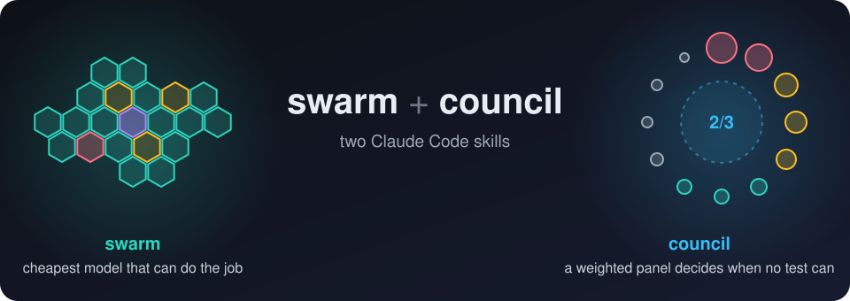
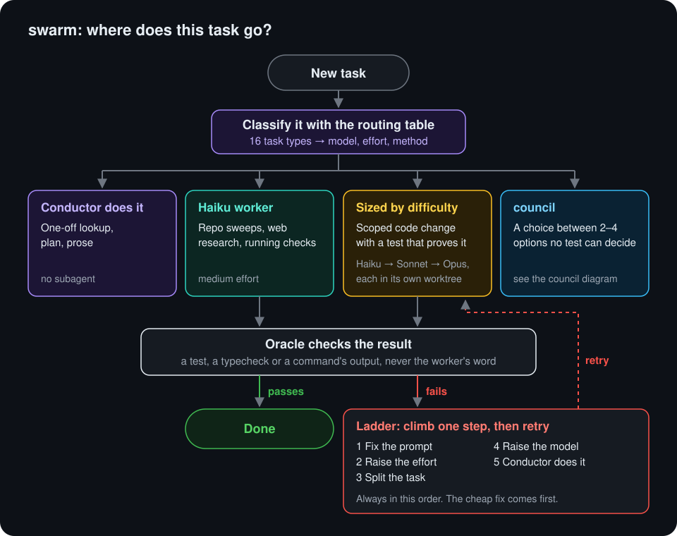
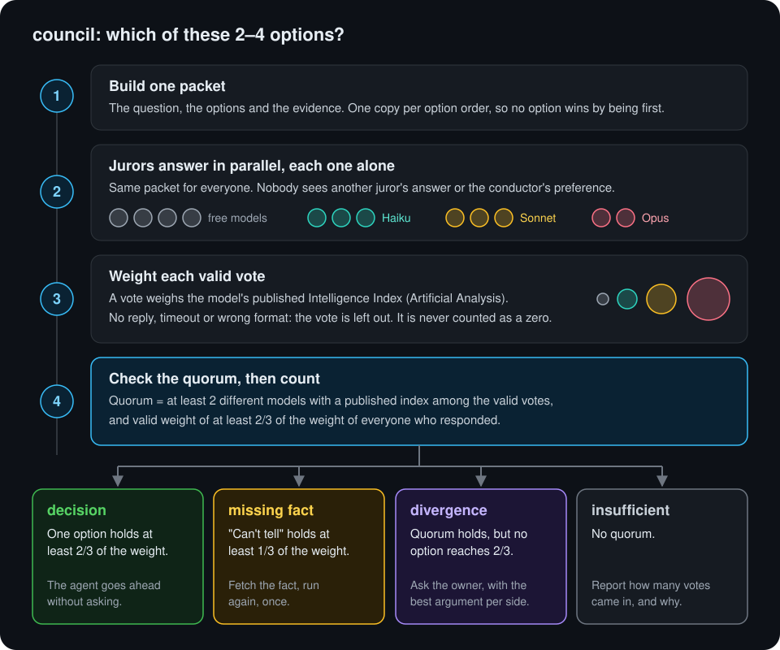
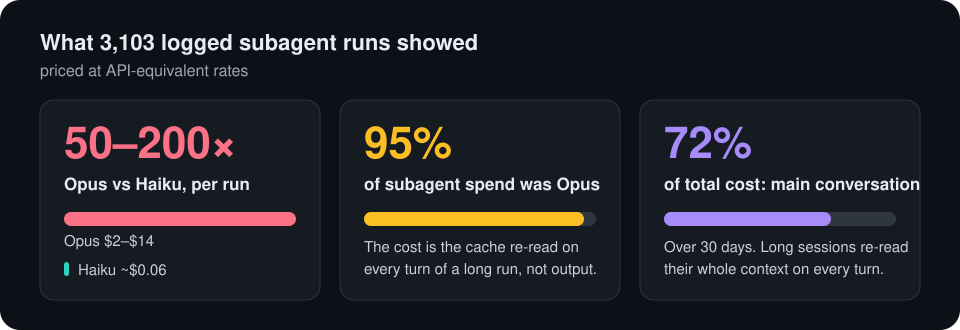

# swarm + council: a Claude Code workflow for running many agents cheaply

**The five-minute version:** read the three diagrams on this page. They show how `swarm` routes a task, how `council` reaches a decision, and what my usage logs say about cost.

This repo is the development workflow from my (gmunaro's) Claude Code setup, in English. I use it every day in T3 Code. Two skills carry most of it:

- **[`swarm`](swarm/SKILL.md)** answers *which model, at what effort, using what method?* before any subagent is launched. It's a routing table built from my own usage logs.
- **[`council`](council/SKILL.md)** answers *which of these 2–4 options?* when no test can decide. It sends the same packet to a panel of models, weights each vote by the model's published Intelligence Index from Artificial Analysis, and only accepts a result when a quorum holds. It also runs **hill climbs**: rounds of scoring and fixing an artifact until it reaches a target score.

Everything else here is what those two call: the methods `swarm` routes to, the agents it launches, the hook that measures cost, and [`CLAUDE.md`](CLAUDE.md), the global instructions they all run under.

Terms used below: **conductor** = the main conversation; **worker** = a subagent; **oracle** = a command whose result decides (a test, typecheck or command output); **juror** = one model on a council panel; **packet** = the question, the options and the evidence sent to every juror; **ladder** = the escalation steps when a worker fails (fix the prompt, raise the effort, split the task, raise the model, or hand it to the conductor).

## How a task flows

## How a decision is made

## Why it exists

I measured 3,103 subagent runs from my own history, priced at API-equivalent rates:

| Finding | Number |
|---|---|
| Opus subagent vs Haiku subagent | $2–$14 vs ~$0.06 per run (50–200×) |
| Opus share of subagent cost | 95% |
| Main conversation (conductor) share of total cost | 72% over 30 days |
| Main driver of cost | cache re-read on every turn of a long run, not output tokens |

So the rules are: the main conversation stays on one model and plans. Cheap models do the long reading. Expensive models only get short, pre-packaged jobs. Every result is checked by a command, never trusted on the worker's word.

[`swarm/scoreboard.md`](swarm/scoreboard.md) is the raw log behind the routing table: one line per A/B test, escalation, or council run, with the outcome and the reason. The lessons at the top of that file are distilled from it. The cost numbers come from [`hooks/telemetria.mjs`](hooks/telemetria.mjs).

## What's in here

### The core

| Path | What it is |
|---|---|
| [`CLAUDE.md`](CLAUDE.md) | My global instructions (`~/.claude/CLAUDE.md`). Sets the conductor rules the skills assume. |
| [`swarm/`](swarm/SKILL.md) | Router table, launch rules, prompt template, large-task playbook. Also [`conducting.md`](swarm/conducting.md) (running workstreams as threads), [`agents.md`](swarm/agents.md) (how to write an agent definition), [`scoreboard.md`](swarm/scoreboard.md) and [`scoreboard-archive.md`](swarm/scoreboard-archive.md). |
| [`council/`](council/SKILL.md) | Triage, decision council, hill-climb loop, agreement vote, quorum. Also [`hill-climb.md`](council/hill-climb.md), [`cold-reader.md`](council/cold-reader.md) (does an outsider understand this?), [`weighted-execution.md`](council/weighted-execution.md) and `scripts/` (Node, 70 tests). |

### Methods swarm routes to

| Skill | When swarm uses it |
|---|---|
| [`ab`](ab/SKILL.md) | More than one plausible way to do it. An oracle picks between edits made in separate worktrees, or lists from different angles are merged. |
| [`ladder`](ladder/SKILL.md) | The task has an oracle and the difficulty is unclear. Start at the cheapest rung with a real chance and climb one rung per failure. |
| [`devils-advocate`](devils-advocate/SKILL.md) | Before executing a plan or after an expensive decision. One Opus agent builds the strongest case against it; Haiku agents check each objection at the source. |
| [`blind-review`](blind-review/SKILL.md) | Before merging non-trivial code. A fresh reviewer gets only the diff, the acceptance criteria and the commands, not the author's intent. |
| [`premortem`](premortem/SKILL.md) | Before a multi-step plan, migration or launch. Four Haiku agents imagine it failed three months from now and list the causes. |

### Media

| Path | What it is |
|---|---|
| [`curation/`](curation/SKILL.md) | A paid jury for images, audio and video. It picks between 2–4 versions of an asset, scores an asset during a hill climb, and generates new candidates ([`generation.md`](curation/generation.md)). Jurors are weighted by a benchmark for that media type. Includes `data/` (juries, generators, scores, the research behind each benchmark choice) and `scripts/` (Node, 109 tests; imports `../council/scripts`). |

### Agents and hook

| Path | What it is |
|---|---|
| [`agents/`](agents) | The six worker definitions swarm launches: `scout`, `researcher`, `auditor`, `implementer`, `reviewer`, and `svg-artist` (Fable 5.2, for every SVG edit). |
| [`hooks/telemetria.mjs`](hooks/telemetria.mjs) | A `SubagentStop` hook that logs model, effort and tokens for every subagent. |

### Support skills

| Skill | What it does |
|---|---|
| [`open-pr`](open-pr/SKILL.md) | Opens a concise PR: problem first, then the fix, then what was verified. |
| [`babysit-pr`](babysit-pr/SKILL.md) | Follows a PR until it is green and approved. |
| [`ask`](ask/SKILL.md) | Answers a question without editing anything. |
| [`new-project`](new-project/SKILL.md) | Plans a new project: scope, MVP, default stack. |
| [`t3`](t3/SKILL.md) | Says which phase of Theo's method the current project is in and what the next step is. |
| [`audit-history`](audit-history/SKILL.md) | Reads past sessions for recurring agent failures and proposes `CLAUDE.md` rules. |
| [`research-videos`](research-videos/SKILL.md) | Researches YouTube videos from their transcripts with Haiku agents. |
| [`unslop`](unslop/SKILL.md) | Cuts AI tells from writing. Third-party: from [cursor/plugins pstack](https://github.com/cursor/plugins/tree/main/pstack) by Lauren Tan, MIT ([license](unslop/LICENSE)). |

## Using it

1. Copy the skill folders into `~/.claude/skills/` and the files in `agents/` into `~/.claude/agents/`.
2. Merge the sections you want from `CLAUDE.md` into your own `~/.claude/CLAUDE.md`. Do not replace the whole file. It sets what the skills assume: Fable 5.2 as the general conductor and Opus 5.5 on each workstream, both at medium effort, one task per session, and `/council` instead of asking the owner when a choice has 2–4 options and no oracle can decide it.
3. Restart Claude Code.

What each part needs:

| Part | Needs |
|---|---|
| `swarm`, the method skills, the agents | Nothing. They are instructions only. |
| `hooks/telemetria.mjs` | Optional. Register it as a `SubagentStop` hook in `~/.claude/settings.json` to get the per-subagent cost log. Its flags keep their Portuguese names (`--resumo`, `--sem-condutor`, `--desde`), because the skills cite them. |
| `council` | The infrastructure listed below, to run the full multi-model panel. |
| `curation` | An OpenRouter key and the council scripts. **It spends money**: it calls paid models, estimates the cost before each paid step and caps each step at $3. |
| `audit-history`, `research-videos` | Editing first. They contain my real paths (`C:/Users/MunaroPC/...`). |
| `ask`, `t3`, `research-videos` | Editing first if you don't want answers in Brazilian Portuguese, which is what my setup asks for. |

**`council` infrastructure:**

- T3 Code's `delegate_task` to launch the Claude jurors as visible child tasks.
- [CLIProxyAPI](https://github.com/router-for-me/CLIProxyAPI) at `http://127.0.0.1:8317/v1`. The key comes from `CLIPROXY_API_KEY` or `~/.t3/secrets/cliproxy-api-key.txt`.
- A local OpenCode server with a free-only guard plugin, for the free OpenRouter models. The plugin is not included.
- Optional: an Artificial Analysis API key (`AA_API_KEY`) for the Intelligence Index. Without it, the scripts read the public pages.

Without that stack you can still use the method by hand: write one packet per option, each listing the options in a different order, ask several models in parallel, weight each vote by its Artificial Analysis Intelligence Index, and apply the quorum rule (at least 2 distinct models with a published index among the valid reviews, and valid weight of at least 2/3 of the weight of those who responded).

## How these texts were checked

The originals are in Portuguese. How much checking each English file got:

| Files | Check | Result |
|---|---|---|
| `swarm`, `council`, `CLAUDE.md`, this README | Translated, then hill-climbed by the council itself for 3 rounds | Weighted means of 8.17 to 8.53 out of 10. The target was 9, and no piece reached it. |
| Sync to the current skills (2026-11-11) | Translated against the current Portuguese source, no council round | Fable 5.2 as conductor and SVG owner, new router types 17–18, new files (`conducting`, `cold-reader`, `generation`, `svg-artist`), curation and telemetry price updates. Tests pass; numbers match the source. |
| Later sync of those files (2026-11-09) | Translated, no council round | New scoreboard lines, one `CLAUDE.md` passage about thread ids, optional parameters in four scripts. |
| Method skills, `curation`, support skills, hook | Translated and compared with the source by the conductor | Tests pass where there are scripts, and the numbers in each file match the source. Not scored by the council. |

How a hill-climb round works: a panel of models (free models plus Haiku, Sonnet and Opus) scores the text with an anchored 1–10 rubric. The panel then votes on each proposed fix, and only fixes with weighted agreement of 7/10 or more are applied. The next round uses fresh jurors who never saw the earlier scores.

The rubric covered clarity for a first-time reader, fidelity to the original, whether the instructions are executable as written, and native-English tone. The target was a weighted mean and median of at least 9, with no category below 8.

The last measured weighted means:

| Piece | Weighted mean |
|---|---|
| `swarm` | 8.17 |
| `council/SKILL.md` | 8.30 |
| Council reference files | 8.21 |
| `CLAUDE.md` | 8.53 |
| This README with the cover email | 8.26 |

The fixes the panel approved in the last round were applied after that measurement and were not scored again. This README was reorganized after its score was measured.

Built on Windows 11 with Claude Code (Fable 5.2 and Opus 5.5 conductors; Haiku 5.5, Sonnet 5.5 and Opus 5.5 workers, chosen by the swarm table).
